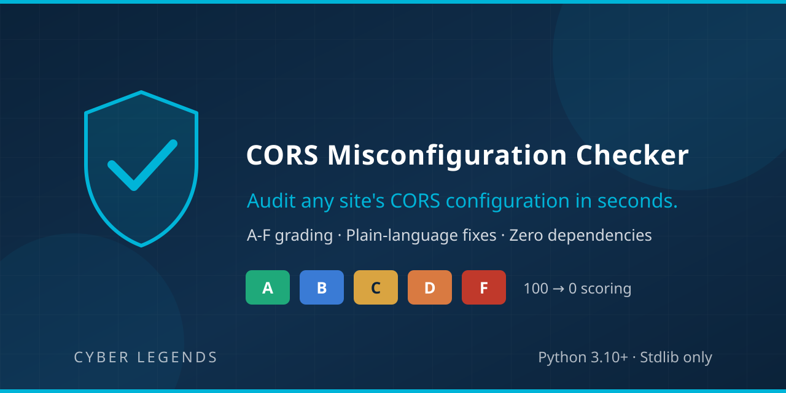
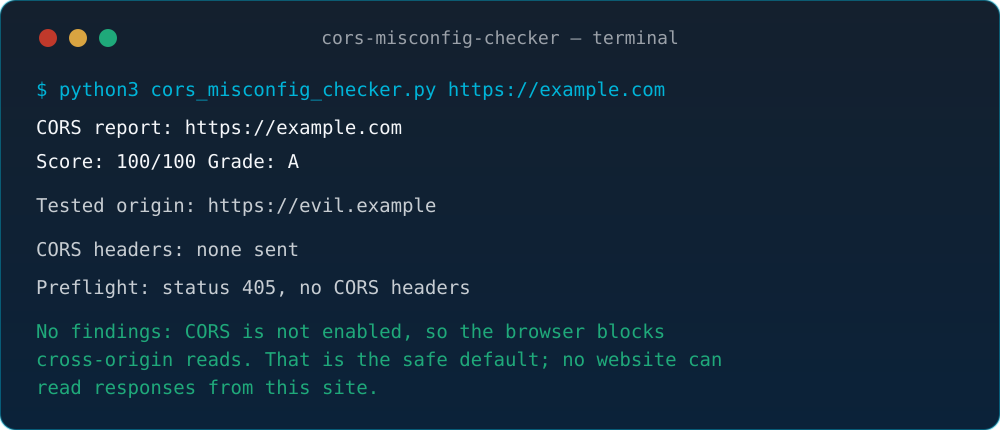
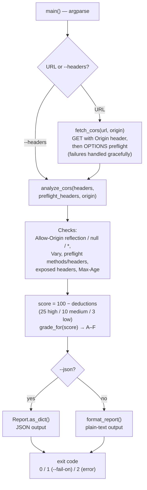

<p align="center">
  
</p>

<h1 align="center">CORS Misconfiguration Checker</h1>

<p align="center"><strong>Audit any website's CORS configuration in seconds, get an A-F grade, and learn exactly how to fix it.</strong></p>

<p align="center">
  <a href="LICENSE"></a>
  <a href="https://github.com/sajidhussainraza/cors-misconfig-checker/releases"></a>
  <a href="https://github.com/sajidhussainraza/cors-misconfig-checker/stargazers"></a>
  <a href="https://github.com/sajidhussainraza/cors-misconfig-checker/network/members"></a>
  <a href="https://github.com/sajidhussainraza/cors-misconfig-checker/issues"></a>
  <a href="https://github.com/sajidhussainraza/cors-misconfig-checker/commits/main"></a>
  <a href="https://github.com/sajidhussainraza/cors-misconfig-checker/actions/workflows/ci.yml"></a>
  <a href="https://www.python.org/downloads/"></a>
  <a href="CONTRIBUTING.md"></a>
</p>

<p align="center">
  <a href="#demo">Demo</a> |
  <a href="#quick-start">Quick Start</a> |
  <a href="#installation">Install</a> |
  <a href="docs/demo-capture.md">Docs</a> |
  <a href="https://github.com/sajidhussainraza/cors-misconfig-checker/issues/new?template=bug_report.yml">Report Bug</a> |
  <a href="https://github.com/sajidhussainraza/cors-misconfig-checker/issues/new?template=feature_request.yml">Request Feature</a>
</p>

## Why this exists

**Problem:** a site that reflects any Origin with credentials lets any
malicious page read its visitors' authenticated data, and most sites
never test what their CORS headers actually do.
**Solution:** this dependency-free Python CLI sends a request with an
attacker-controlled Origin (plus an OPTIONS preflight, the way a
browser would), checks the CORS headers it gets back against the
standard hardening rules, and grades the configuration A-F with a
plain-language fix for every finding.
**Result:** you know in seconds whether a site's CORS setup would let
an attacker website read its responses, and exactly which header to
change first.

## Demo



> Static preview, not an animated GIF: the image above is a rendering of
> real output (the full output is saved in
> [`examples/sample-output-example.com.txt`](examples/sample-output-example.com.txt)).
> A real demo GIF has not been recorded yet; the exact capture script is in
> [`docs/demo-capture.md`](docs/demo-capture.md).

## Features

- 🔒 **A-F grading with a 0-100 score** — compare any two CORS
  configurations at a glance, and track a configuration as you tighten it
- 🗣️ **Plain-language findings, each with a fix** — no jargon, no guessing what to change next
- 🧨 **Catches the dangerous patterns** — reflected Origin with
  credentials, the literal `null` origin, `*` with credentials, and
  wildcard preflight methods and headers
- 🕳️ **Checks the headers everyone forgets** — `Vary: Origin`,
  `Access-Control-Expose-Headers`, and `Access-Control-Max-Age`
- ✈️ **Real preflight audit** — sends an OPTIONS preflight with
  `Access-Control-Request-Method` and
  `Access-Control-Request-Headers`, the way a browser does before a
  cross-origin request with custom headers
- 🧠 **Smart about the safe default** — a site that sends no
  `Access-Control-Allow-Origin` at all scores 100, because the browser
  blocks cross-origin reads; and it knows browsers refuse credentialed
  responses when ACAO is `*`, so that is a broken config, not a leak
- 📴 **Offline mode** — audit any header string with `--headers` (and
  `--preflight-headers`), no network needed
- 🤖 **CI ready** — `--json` for machine-readable output and
  `--fail-on` to fail a build on findings above a severity, so a weak
  CORS configuration can block a deploy
- 🪶 **Zero dependencies** — Python standard library only, nothing to install, nothing to update

## Table of contents

- [Quick Start](#quick-start)
- [Installation](#installation)
- [Usage](#usage)
- [CLI reference](#cli-reference)
- [Configuration](#configuration)
- [How grading works](#how-grading-works)
- [What it checks](#what-it-checks)
- [Live results](#live-results)
- [Architecture](#architecture)
- [Project structure](#project-structure)
- [Teaching notes](#teaching-notes)
- [Tests](#tests)
- [FAQ](#faq)
- [Roadmap](#roadmap)
- [Contributing](#contributing)
- [License](#license)
- [Acknowledgements](#acknowledgements)

## Quick Start

The fastest path to a working result, under 60 seconds. You need only
Python 3.10+; there is nothing to install.

```bash
git clone https://github.com/sajidhussainraza/cors-misconfig-checker.git
cd cors-misconfig-checker
python3 cors_misconfig_checker.py https://example.com
```

Expected output (real output, captured 20 November 2026):

```
CORS report: https://example.com
Score: 100/100  Grade: A

  Tested origin: https://evil.example
  CORS headers: none sent
  Preflight: status 405, no CORS headers

No findings: CORS is not enabled, so the browser blocks cross-origin reads. That is the safe default; no website can read responses from this site.
```

A site with no CORS headers at all scores 100/100 (A), because the
browser blocks cross-origin reads by default. The tool only deducts
points for a configuration that *opens* the site up. See
[How grading works](#how-grading-works) and the [FAQ](#faq).

## Installation

### Prerequisites

| Requirement | Version | Notes |
| --- | --- | --- |
| Python | 3.10 or newer | 3.10+ is required: the code uses `str \| None` annotations (PEP 604). Check with `python3 --version`. |
| Git | Any recent version | Only needed to clone the repo; you can also download the ZIP from GitHub. |
| Internet access | — | Only needed to audit a live URL. `--headers` mode works fully offline. |
| Third-party packages | None | Standard library only (`urllib`, `ssl`, `json`, `argparse`). There is no `requirements.txt` because there is nothing to install. |

### Windows

```powershell
git clone https://github.com/sajidhussainraza/cors-misconfig-checker.git
cd cors-misconfig-checker
py cors_misconfig_checker.py https://example.com
```

Use `py` (the Python launcher) if `python3` is not recognised. On
Windows, `python` usually works too.

### macOS

```bash
git clone https://github.com/sajidhussainraza/cors-misconfig-checker.git
cd cors-misconfig-checker
python3 cors_misconfig_checker.py https://example.com
```

macOS ships a system Python that may be older than 3.10. If
`python3 --version` reports below 3.10, install a newer Python from
[python.org](https://www.python.org/downloads/) or with
`brew install python`.

### Linux

```bash
git clone https://github.com/sajidhussainraza/cors-misconfig-checker.git
cd cors-misconfig-checker
python3 cors_misconfig_checker.py https://example.com
```

Most current distributions already ship Python 3.10+. On Debian/Ubuntu,
`sudo apt install python3` gets you a working interpreter.

### Install from source

There is no package to install and no build step. Cloning the repo
*is* the install: `cors_misconfig_checker.py` is a single
self-contained file. Copy it anywhere and run it:

```bash
cp cors_misconfig_checker.py /usr/local/bin/cors-checker   # optional, Linux/macOS
chmod +x /usr/local/bin/cors-checker
cors-checker https://example.com
```

### Verify the install

```bash
python3 tests/run_tests.py   # 41 tests, including a live audit of github.com
python3 cors_misconfig_checker.py --headers "Access-Control-Allow-Origin: https://app.example"
```

The second command should print `Score: 100/100  Grade: A` and exit 0.
If the live test is skipped, the network was unreachable; the other
40 tests still prove the install works.

### Troubleshooting

| Error | Cause | Fix |
| --- | --- | --- |
| `python3: command not found` | Python is not installed, or not on PATH | Install Python 3.10+ from python.org; on Windows use `py` instead of `python3` |
| `Error: URL must start with http:// or https://` (exit 2) | The URL was missing its scheme | Run `python3 cors_misconfig_checker.py https://example.com`, not `example.com` |
| `Error: could not reach the site (...)` (exit 2) | The site is down, the network is off, or a proxy blocks the request | Check the URL in a browser; retry on a working network |
| `Error: Give a URL to audit or headers with --headers` (exit 2) | No URL and no `--headers` were given | Give one or the other, not neither |
| `Error: --headers and a URL cannot be used together` (exit 2) | Both were given at once | Audit the URL, or the header string, in separate runs |
| `Error: --preflight-headers needs --headers (...)` (exit 2) | Preflight headers were given without `--headers` | Add `--headers` for offline mode; a live audit fetches its own preflight |
| `SyntaxError` on `str \| None` | Python older than 3.10 | Upgrade to Python 3.10+; this syntax (PEP 604) does not work on 3.8/3.9 |
| `SSLError` / certificate errors | The site's certificate is invalid, or a corporate proxy intercepts TLS | That is a finding about the site, not this tool; audit the headers with `--headers` instead |

## Usage

### Basic: audit a live site

This CORS audit sends a GET with `Origin: https://evil.example` and
an OPTIONS preflight, then grades the headers the site sends back. It
is the core use case for this CORS checker: a quick web security check
of any site's cross-origin configuration.

```bash
python3 cors_misconfig_checker.py https://api.github.com
```

```
CORS report: https://api.github.com
Score: 97/100  Grade: A

  Tested origin: https://evil.example
  Access-Control-Allow-Origin: *
  Access-Control-Expose-Headers: ETag, Link, Location, Retry-After, X-GitHub-OTP, X-RateLimit-Limit, X-RateLimit-Remaining, X-RateLimit-Used, X-RateLimit-Resource, X-RateLimit-Reset, X-OAuth-Scopes, X-Accepted-OAuth-Scopes, X-Poll-Interval, X-GitHub-Media-Type, X-GitHub-SSO, X-GitHub-Request-Id, Deprecation, Sunset, Warning
  Vary: Accept,Accept-Encoding, Accept, X-Requested-With
  Preflight:
    Access-Control-Allow-Methods: GET, POST, PATCH, PUT, DELETE
    Access-Control-Allow-Headers: Authorization, Content-Type, If-Match, If-Modified-Since, If-None-Match, If-Unmodified-Since, Accept-Encoding, X-GitHub-OTP, X-Requested-With, User-Agent, GraphQL-Features, X-Github-Next-Global-ID, X-GitHub-Api-Version, X-Fetch-Nonce, Copilot-Integration-Id, DD-CLIENT-TOKEN, X-Client-Application, X-Experiment-Commit-Agent-Version, Idempotency-Key
    Access-Control-Max-Age: 86400
    (preflight status: 204)

Findings (1):
  [LOW] Access-Control-Allow-Origin: Access-Control-Allow-Origin is '*', so any website can read the response. That is fine for genuinely public data and wrong for anything sensitive.
        Fix: If the response is ever sensitive, replace '*' with an allow-list of the exact origins that need access.
```

The full output for this audit is saved in
[`examples/sample-output-api.github.com.txt`](examples/sample-output-api.github.com.txt).

### Intermediate: audit headers offline, and get JSON

Analyse header values directly. Nothing is fetched, so this works
offline and is ideal for testing a configuration before you deploy it:

```bash
python3 cors_misconfig_checker.py --headers "Access-Control-Allow-Origin: https://evil.example; Access-Control-Allow-Credentials: true; Vary: Origin"
```

```
CORS report: CORS header analysis
Score: 75/100  Grade: B

  Tested origin: https://evil.example
  Access-Control-Allow-Origin: https://evil.example
  Access-Control-Allow-Credentials: true
  Vary: Origin
  Preflight: no response (not a CORS endpoint, or the preflight failed)

Findings (1):
  [HIGH] Access-Control-Allow-Origin: Access-Control-Allow-Origin echoes the request Origin and Access-Control-Allow-Credentials is true, so any website can read authenticated responses from this site, including a logged-in victim's data.
        Fix: Stop reflecting arbitrary origins. Allow-list only the exact origins the site serves, and keep credentials off unless a listed origin genuinely needs them.
```

Test with a different origin using `--origin`:

```bash
python3 cors_misconfig_checker.py --headers "Access-Control-Allow-Origin: https://app.example" --origin https://app.example
```

Testing with an origin the site actually allows is the point: here
the header echoes `https://app.example` back, so the tool reports a
medium reflection finding plus a low missing-`Vary` finding, scoring
87/100 (B). A fixed allow-list only passes when the tested origin is
*not* the one being allowed.

Machine-readable output for scripts and dashboards:

```bash
python3 cors_misconfig_checker.py --headers "Access-Control-Allow-Origin: https://evil.example; Access-Control-Allow-Credentials: true" --json
```

```json
{
  "url": null,
  "status": null,
  "origin": "https://evil.example",
  "cors_enabled": true,
  "headers": {
    "access-control-allow-origin": "https://evil.example",
    "access-control-allow-credentials": "true"
  },
  "preflight_headers": {},
  "preflight_status": null,
  "score": 72,
  "grade": "C",
  "findings": [
    {
      "severity": "high",
      "header": "access-control-allow-origin",
      "message": "Access-Control-Allow-Origin echoes the request Origin and Access-Control-Allow-Credentials is true, so any website can read authenticated responses from this site, including a logged-in victim's data.",
      "fix": "Stop reflecting arbitrary origins. Allow-list only the exact origins the site serves, and keep credentials off unless a listed origin genuinely needs them."
    }
  ]
}
```

(Only the first finding is shown; the full output lists every finding.
Without `Vary: Origin` the same headers also earn a low cache-poisoning
finding, which is why this run scores 72 and the previous one 75.)

### Advanced: use it as a CI security gate

Fail a build when the configuration has high-severity findings, for
example in a GitHub Actions step after deploying a preview site:

```bash
python3 cors_misconfig_checker.py https://staging.example.com --fail-on high
echo $?   # 1: a high-severity finding was found; 0: clean at that level
```

Combine it with `--json` to feed the findings into your own reporting:

```bash
python3 cors_misconfig_checker.py https://staging.example.com --json --fail-on medium > cors-report.json
```

#### Exit codes

| Code | Meaning |
| --- | --- |
| 0 | No findings at or above `--fail-on` |
| 1 | Findings at or above `--fail-on` were found |
| 2 | Usage error (bad URL, site unreachable) |

Note: the checker only reads the headers a site sends on an anonymous
visit. It cannot audit a configuration served only after login, or one
applied by JavaScript in the browser.

## CLI reference

| Flag / argument | Description |
| --- | --- |
| `url` (positional) | Website URL to audit, e.g. `https://example.com`. Must start with `http://` or `https://`. |
| `--origin ORIGIN` | Origin to test with, e.g. `https://evil.example`. Default: `https://evil.example`. |
| `--headers TEXT` | Analyse CORS headers directly, as a semicolon-separated list of `"Name: value"` pairs (no network needed). Cannot be combined with a URL. |
| `--preflight-headers TEXT` | Preflight response headers in the same format, used with `--headers`. |
| `--json` | Print the report as JSON instead of plain text. |
| `--fail-on {high,medium,low,none}` | Exit 1 when findings at or above this severity are found. Default: `none` (always exit 0 unless there is a usage or network error). |
| `-h`, `--help` | Show the built-in help and exit. |

There is no `--version` flag yet; the version is in `__version__`
at the top of `cors_misconfig_checker.py` (currently `1.0.0`). Adding one is on
the [roadmap](#roadmap).

## Configuration

There is no configuration file and no environment variable to set.
Every behaviour is controlled by the command-line flags above.

| Option | Type | Default | Description |
| --- | --- | --- | --- |
| `url` | string | — | Site to audit. |
| `--origin` | string | `https://evil.example` | Origin sent with the request. |
| `--headers` | string | — | Header values to analyse offline. |
| `--preflight-headers` | string | — | Preflight header values to analyse offline. |
| `--json` | flag | off | JSON output instead of plain text. |
| `--fail-on` | `high` / `medium` / `low` / `none` | `none` | Severity threshold that makes the exit code 1. |
| Request timeout | — | 15 seconds | Fixed in `fetch_cors`; not currently configurable (see roadmap). |
| User-Agent | — | `cors-misconfig-checker/1.0` | Sent with the audit request. |

No secrets are involved anywhere: the tool sends only anonymous
read-only GET and OPTIONS requests and stores nothing.

## How grading works

Score starts at 100 and deducts **25 / 10 / 3** per high / medium / low
finding:

| Score | Grade |
| --- | --- |
| 90-100 | A |
| 75-89 | B |
| 60-74 | C |
| 40-59 | D |
| 0-39 | F |

Findings are graded by severity:

| Severity | Examples |
| --- | --- |
| High | Reflected Origin with credentials, `null` origin |
| Medium | Reflected Origin without credentials, `*` with credentials, wildcard preflight methods or headers with credentials |
| Low | `*` without credentials, missing `Vary: Origin` on a reflected origin, wildcard preflight methods or headers without credentials, `*` in exposed headers, preflight cache over one day |

## What it checks

| Check | What a good result looks like |
| --- | --- |
| `Access-Control-Allow-Origin` present | Either no header at all (CORS off, the safe default) or a fixed, named origin |
| Reflected Origin + credentials | Never: reflecting the request Origin while allowing credentials lets any site read authenticated responses |
| `null` origin | Never allowed: sandboxed iframes and `data:` URLs send `null` as their origin |
| Reflected Origin, no credentials | Never: any site can still read responses that need no credentials |
| `*` with credentials | Never: browsers refuse credentialed responses when ACAO is `*`, so the config is broken as well as sloppy |
| `*` without credentials | Only for genuinely public data; sensitive responses need a named allow-list |
| `Vary: Origin` | Present whenever the origin is reflected, so caches do not serve one origin's response to another |
| Preflight `Access-Control-Allow-Methods` | Named methods only (`GET`, `POST`, ...), never `*` |
| Preflight `Access-Control-Allow-Headers` | Named headers only, never `*` |
| `Access-Control-Expose-Headers` | Named headers only, never `*` |
| `Access-Control-Max-Age` | 86400 seconds (one day) or less, so a bad preflight answer is not cached for long |

Two subtleties are handled, not just pattern-matched:

- No `Access-Control-Allow-Origin` is a pass, not a failure. CORS is
  opt-in: without the header the browser blocks cross-origin reads,
  so a site that never enabled CORS is safe by default.
- `*` with credentials is medium, not high, and for the right reason:
  browsers refuse to expose a credentialed response when ACAO is `*`,
  so it cannot leak credentials directly. It is still flagged, because
  it shows the configuration was never thought through and it breaks
  legitimate credentialed use.

Known limitation: the checker sends one test origin. A site that
reflects only *some* origins (an allow-list with a flaw) needs a
separate run per origin, for example with `--origin`. See the
[roadmap](#roadmap).

## Live results

Real audits, captured 20 November 2026. Full outputs are saved in
[`examples/`](examples/).

| Site | Score | Grade | What stood out |
| --- | --- | --- | --- |
| [example.com](https://example.com) | 100/100 | A | No CORS headers at all; the safe default |
| [github.com](https://github.com) | 100/100 | A | No CORS headers at all; the safe default |
| [api.github.com](https://api.github.com) | 97/100 | A | `Access-Control-Allow-Origin: *` for public API data; preflight is tight (named methods and headers, max-age exactly one day) |

`api.github.com` deserves a careful read rather than a shrug: `*` is
the right answer for a public API that serves no authenticated
browser traffic, and its preflight names every method and header
instead of using `*`. The single low finding is a reminder, not a
verdict: the moment that API serves anything sensitive, `*` has to go.

## Architecture



The tool is a single file with no dependencies: `fetch_cors` does the
two network calls, `analyze_cors` is a pure function of the header
values (so it is easy to test offline), and the output layer is
separate from the analysis.

## Project structure

```
cors-misconfig-checker/
├── cors_misconfig_checker.py   # The whole tool: fetch, analyse, grade, report
├── README.md                   # This file
├── LICENSE                     # MIT
├── CHANGELOG.md                # Version history (Keep a Changelog + SemVer)
├── CONTRIBUTING.md             # How to contribute
├── CODE_OF_CONDUCT.md          # Contributor Covenant 2.1
├── SECURITY.md                 # How to report a vulnerability
├── .gitignore                  # Python / editor / OS artefacts
├── .editorconfig               # Indentation and line endings
├── assets/
│   ├── banner.svg              # README banner (1280x640)
│   ├── logo.svg                # Square logo, works at 64px
│   └── demo.svg                # Static terminal preview shown above
├── docs/
│   └── demo-capture.md         # Exact script for recording a real demo.gif
├── examples/
│   ├── sample-output-example.com.txt
│   ├── sample-output-github.com.txt
│   └── sample-output-api.github.com.txt
├── tests/
│   ├── test_cors_misconfig_checker.py  # 41 tests (stdlib unittest)
│   └── run_tests.py            # Test runner, no pytest needed
└── .github/
    ├── ISSUE_TEMPLATE/
    │   ├── bug_report.yml
    │   ├── feature_request.yml
    │   └── config.yml
    ├── PULL_REQUEST_TEMPLATE.md
    └── workflows/
        └── ci.yml              # Tests on Ubuntu / Windows / macOS, Python 3.10-3.13
```

## Comparison with alternatives

Skipped: no competing tools were given to compare against, so there is
no comparison table here. If you know a CORS checker this should be
measured against, open a
[feature request](https://github.com/sajidhussainraza/cors-misconfig-checker/issues/new?template=feature_request.yml)
and it can be added with real, verifiable numbers.

## Teaching notes

This tool pairs well with a lesson on the same-origin policy and how
CORS relaxes it: run it against a deliberately loose demo
configuration, then tighten one header at a time and watch the grade
move. Good discussion points:

- Why the same-origin policy is the default and CORS is the exception:
  without an `Access-Control-Allow-Origin` header the browser already
  blocks the read, so CORS only ever *opens* a site up.
- Why reflecting the Origin is the classic bug: the server cannot tell
  a trusted frontend from an attacker's page, so it hands both the
  same answer.
- Why credentials change everything: without them an attacker only
  reads public data; with them they read the victim's logged-in
  session.
- Why `null` is not a safe origin: sandboxed iframes and `data:` URLs
  send `null`, so allowing it is the same as allowing an attacker page.
- Why `*` with credentials is broken, not just sloppy: the browser
  refuses to expose the response, so legitimate credentialed use
  breaks while the configuration still looks permissive.
- Why the preflight exists: the browser asks permission before sending
  a request with custom headers or a non-simple method, so the
  preflight answer is part of the security boundary, not a formality.
- Why `Vary: Origin` matters: without it a shared cache can serve the
  response meant for one origin to a completely different one.

## Tests

```bash
python3 tests/run_tests.py   # 41 tests, including a live audit of github.com
```

41/41 tests pass. The offline and CLI tests need no internet. The live
test runs a real audit against github.com and is skipped automatically
when the network is unreachable. (pytest is also supported if it is
installed: `python3 -m pytest tests/ -q`.)

## FAQ

**Why does example.com score 100/100 (A) with no CORS headers at all?**
Because no headers means CORS is not enabled, and the browser blocks
cross-origin reads by default. The score grades the configuration as
sent; a site that never opened itself up has nothing wrong to deduct
for. A site with a bad configuration and a site with no configuration
are not the same thing.

**Is `Access-Control-Allow-Origin: *` dangerous?**
It depends on what the response contains. `*` lets any website read
the response, so it is fine for genuinely public data (like
`api.github.com`) and wrong for anything sensitive. With credentials
it is worse: browsers refuse to expose credentialed responses when
ACAO is `*`, so the configuration is broken as well as sloppy. Either
way, a named allow-list is the safe answer for anything that is not
public.

**What is a preflight?**
Before a cross-origin request with custom headers or a non-simple
method (anything beyond a plain GET/POST form), the browser first
sends an OPTIONS request asking the server what is allowed. The
server answers with `Access-Control-Allow-Methods`,
`Access-Control-Allow-Headers`, and `Access-Control-Max-Age`. This
tool sends that OPTIONS request itself and grades the answer.

**Can it audit a site behind a login?**
No. It sends anonymous GET and OPTIONS requests and reads the response
headers. A configuration served only after login, or applied by
JavaScript in the browser, is invisible to it. Paste the headers into
`--headers` mode instead.

**What origin should I test with?**
The default, `https://evil.example`, stands in for an attacker's
website. If your site allow-lists specific origins, test each one
with `--origin`: a configuration that reflects only some origins needs
a separate run per origin to catch a flawed allow-list.

**Why is a reflected Origin without credentials only medium, not high?**
Without credentials an attacker can only read responses the browser
would send to anyone: public API data, CSRF tokens on public pages,
that sort of thing. It is still a real hole, because those responses
are often more sensitive than they look, but it cannot read a
logged-in victim's data the way reflected Origin *with* credentials
can.

**Does it work on Windows?**
Yes. Any machine with Python 3.10+ runs it; use `py` instead of
`python3` if that is how Python is launched on your machine. CI tests
it on Ubuntu, Windows, and macOS.

**Can I use it in CI?**
Yes. `--json` gives machine-readable output and `--fail-on` turns
findings into a failing build. See
[Advanced usage](#advanced-use-it-as-a-ci-security-gate).

## Roadmap

- [ ] Record a real `demo.gif` (capture script: [`docs/demo-capture.md`](docs/demo-capture.md))
- [ ] Add a `--version` flag (the version exists as `__version__` but has no flag yet)
- [ ] Add a `--timeout` flag for the audit request (currently fixed at 15 seconds)
- [ ] Add a `--suggest` mode that prints a safe CORS configuration for the audited site
- [ ] Test several origins in one run, to catch allow-lists with a flaw
- [ ] Check `Access-Control-Allow-Private-Network` (Private Network Access)
- [ ] HTML report output alongside text and JSON
- [ ] Publish to PyPI (only if there is demand; the single-file script works fine as-is)

## Contributing

Contributions are welcome. See [CONTRIBUTING.md](CONTRIBUTING.md) for
the full guide. The short version:

1. Fork the repository and create a branch for your change.
2. Keep the tool dependency-free (Python standard library only).
3. Add or update tests in `tests/` for any behaviour you change.
4. Run the full suite and make sure all 41 tests pass:
   `python3 tests/run_tests.py`
5. Open a pull request describing the change and why it helps.

Please also follow the [Code of Conduct](CODE_OF_CONDUCT.md), and
report security issues privately as described in
[SECURITY.md](SECURITY.md) — do not open a public issue for them.

## License

MIT. See [LICENSE](LICENSE) for the full text.

## Acknowledgements

- The [MDN CORS guide](https://developer.mozilla.org/en-US/docs/Web/HTTP/CORS)
  for the reference behaviour this tool checks against.
- The [Contributor Covenant](https://www.contributor-covenant.org/) for
  the Code of Conduct, and [Keep a Changelog](https://keepachangelog.com/)
  for the changelog format.
- Everyone who reports a wrong score with real headers to back it up:
  that is how the checks get better.

## Star history

[](https://star-history.com/#sajidhussainraza/cors-misconfig-checker&Date)

## Contributors

[](https://github.com/sajidhussainraza/cors-misconfig-checker/graphs/contributors)

---

Built by [Cyber Legends](https://cyberlegends.org) — cybersecurity
trainings, services and solutions.

**If this saved you time, please star the repo.**
